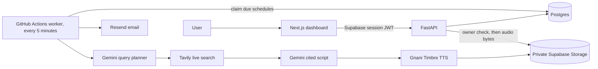

# Daily Context

Daily Context turns a topic and a local delivery time into a source-linked, roughly five-minute audio briefing. Users sign in with a Supabase email link, create or pause daily schedules, and listen to their private episodes from the dashboard. When an episode is ready, the worker emails a link back to that signed-in dashboard.

## How it works



The worker uses Postgres rows as a durable queue. A transaction locks a due briefing, records an episode, and advances the next local-time occurrence. Episode generation moves through `queued`, `generating`, and `ready` or `failed`; stale jobs are recovered after a worker restart. Attempts use exponential backoff. A Postgres advisory lock prevents overlapping scheduled runs and duplicate TTS requests. The GitHub Actions workflow checks for due work every five minutes and processes one episode per run. Scheduled actions can start late, so delivery is approximate to the selected time. Row-level security is enabled on the application tables, and direct Data API access is revoked from `anon` and `authenticated`; user requests go through FastAPI, which verifies the Supabase token and filters every record by its owner ID.

Research is bounded: Gemini plans up to three complementary searches, Tavily retrieves recent news and source snippets for the selected window, and Gemini writes the cited script using only those snippets. If no sources are found, the job fails rather than inventing an episode. Audio is synthesized with Gnani Timbre and saved in a private bucket. The API checks the verified Supabase user ID on every briefing, episode, and audio request. Audio is fetched through the API, so the bucket and object URLs are never public.

Daily schedules use IANA time zones. A repeated wall time during a daylight-saving transition runs once at the first occurrence; a nonexistent wall time is skipped until the next valid day. If the worker is offline across several scheduled times, it creates one catch-up episode and advances to the next future local-time occurrence.

## Stack

- **Web:** Next.js App Router, React, Supabase Auth magic links
- **API:** FastAPI, SQLAlchemy, PostgreSQL, Supabase JWT verification
- **Worker:** Python worker on a GitHub Actions schedule, Postgres queue and advisory lock
- **Research and script:** Tavily Search plus Gemini API
- **Speech:** Gnani Timbre REST TTS, MP3 output
- **Audio storage:** private Supabase Storage bucket
- **Email:** Resend
- **Deployment:** Vercel Hobby for the web app, Render Free for the API, GitHub Actions for scheduled jobs, and Supabase Free for Auth, Postgres, and Storage

## Set up the services

1. Create a Supabase project. In the SQL editor, run [`api/migrations/001_initial.sql`](api/migrations/001_initial.sql). Create a **private** Storage bucket named `episodes`.
2. In Supabase Auth, enable email sign-in. Set the Site URL to the deployed web URL. Add `https://<web-host>/auth/callback**` and `http://localhost:3000/auth/callback**` to the allowed redirect URLs. The app carries the episode link through the sign-in callback.
3. In Resend, verify a sender domain and create a sending-only API key for that domain. Configure Supabase Auth custom SMTP with host `smtp.resend.com`, port `465`, username `resend`, and the Resend API key as the password. Supabase's default SMTP is restricted to project team addresses, so custom SMTP is required for other users. Use the same key for the worker's `RESEND_API_KEY`, and set `EMAIL_FROM` to an address on the verified domain.
4. Get personal keys from the [Tavily dashboard](https://app.tavily.com/home), [Google AI Studio](https://aistudio.google.com/apikey), and the Gnani dashboard. The app defaults to `gemini-3.5-flash-lite` and Gnani `timbre-v3.0` with voice `Shivani`; each can be changed with environment variables.
5. In Supabase project settings, copy the project URL, publishable key, and service-role/secret key. Get the Postgres connection string from the Supabase **Connect** dialog. For Render, use the **Session pooler** connection string, not a manually composed host. Replace the password placeholder and URL-encode reserved characters in the password.
6. Create `api/.env` from [`api/.env.example`](api/.env.example) only if it does not already exist. If it does, merge in missing settings so existing keys are preserved. Create `web/.env.local` from [`web/.env.example`](web/.env.example). Use personal keys and keep the Supabase service-role key only in the API, worker, and GitHub Actions secret stores. Never commit either env file.

The API converts `postgres://` and `postgresql://` database URLs to the `postgresql+psycopg://` SQLAlchemy driver. Use the Supabase Postgres connection string with SSL enabled. The service-role key is used only for server-side access to the private audio bucket. In Vercel, set `NEXT_PUBLIC_SUPABASE_URL`, `NEXT_PUBLIC_SUPABASE_ANON_KEY` (or the publishable key), and `NEXT_PUBLIC_API_URL`. In Render, set `DATABASE_URL`, `SUPABASE_URL`, `SUPABASE_PUBLISHABLE_KEY`, `SUPABASE_SERVICE_ROLE_KEY`, and `AUDIO_BUCKET`. Set `CORS_ORIGINS` to the exact Vercel web origin. In GitHub repository settings, add Actions secrets named `DATABASE_URL`, `SUPABASE_URL`, `SUPABASE_SERVICE_ROLE_KEY`, `TAVILY_API_KEY`, `GEMINI_API_KEY`, `GNANI_API_KEY`, `RESEND_API_KEY`, `EMAIL_FROM`, and `APP_URL`. Add the repository variable `ENABLE_SCHEDULED_WORKER=true` only after all secrets are configured. The scheduled job stays disabled until that variable is set.

## Run locally

Apply the SQL migration to the configured Supabase database, then start the API, worker, and web app in separate terminals:

```bash
cd api
uv sync
uv run uvicorn app.main:app --reload --port 8000
```

```bash
cd api
uv run python -m app.worker
```

```bash
cd web
npm install
npm run dev
```

The web app uses `NEXT_PUBLIC_API_URL=http://localhost:8000` by default. The API reads its settings from environment variables. The worker needs database, Supabase Storage, Tavily, Gemini, Gnani, and Resend configuration before it starts.

## Deploy

### Render API

Connect this repository to Render and use [`render.yaml`](render.yaml) as a Blueprint. It creates only the FastAPI service on Render's Free web plan. Add `DATABASE_URL`, `SUPABASE_URL`, `SUPABASE_PUBLISHABLE_KEY`, `SUPABASE_SERVICE_ROLE_KEY`, and `CORS_ORIGINS` to that service.

The Render Blueprint creates only a Free web service. Free Render web services sleep after 15 minutes without inbound traffic and take about a minute to start on the next request. Free instances also share a 750-hour monthly allowance across the workspace. With a payment method attached, Render can bill for bandwidth or build-pipeline usage above the included amounts; without one, it suspends service or new builds when those amounts are exceeded. The scheduler runs as a GitHub Actions workflow, which is free for standard hosted runners on public repositories. It checks every five minutes, and GitHub may delay scheduled runs during high load. GitHub disables scheduled workflows on public repositories after 60 days without repository activity. See the [Render Free plan limits](https://render.com/docs/free), [GitHub schedule behavior](https://docs.github.com/en/actions/reference/workflows-and-actions/events-that-trigger-workflows), and [GitHub Actions billing](https://docs.github.com/en/billing/concepts/product-billing/github-actions). Provider APIs may have separate usage limits or charges.

### GitHub Actions worker

The [`scheduled-worker.yml`](.github/workflows/scheduled-worker.yml) workflow runs one worker cycle every five minutes. In the repository, open **Settings → Secrets and variables → Actions** and add the listed secrets. Also add repository variable `ENABLE_SCHEDULED_WORKER` with value `true` after all secrets are in place. The workflow has a manual **Actions → Scheduled briefing worker → Run workflow** trigger for initial verification.

### Vercel web app

Import the `web/` directory as the Vercel project root and set `NEXT_PUBLIC_SUPABASE_URL`, `NEXT_PUBLIC_SUPABASE_ANON_KEY` (or the Supabase publishable key), and `NEXT_PUBLIC_API_URL` to the public Render API URL. Deploy the API first, then the web app. After Vercel assigns the production URL, set it as `APP_URL` in GitHub Actions and as the API's `CORS_ORIGINS` in Render. Add the site URL and `/auth/callback**` redirect to Supabase Auth. Vercel Hobby is free for personal projects; see [Vercel Hobby plan](https://vercel.com/docs/plans/hobby).

## API surface

| Method | Path | Purpose |
| --- | --- | --- |
| `GET` | `/health` | Render health check |
| `GET` | `/api/v1/briefings` | List the signed-in user's briefings |
| `POST` | `/api/v1/briefings` | Create a daily schedule |
| `PATCH` | `/api/v1/briefings/{id}` | Pause or resume a schedule |
| `DELETE` | `/api/v1/briefings/{id}` | Delete the schedule, episodes, and stored audio |
| `GET` | `/api/v1/episodes` | List the user's latest 50 episodes |
| `GET` | `/api/v1/episodes/{id}/audio` | Stream private audio after ownership check |

## Project map

- `web/`: sign-in, dashboard, schedule controls, transcript/source view, authenticated playback
- `api/app/main.py`: authenticated API and owner-scoped reads/writes
- `api/app/worker.py`: due-time scheduler, retries, generation and email delivery
- `api/app/research.py`: query planning, current search, source curation and cited script writing
- `api/app/providers.py`: Gnani TTS, Supabase Storage, and Resend integrations
- `api/migrations/001_initial.sql`: initial database schema and queue indexes

## Provider references

- [Gnani TTS REST API](https://docs.gnani.ai/api/TTS/tts-inference)
- [Tavily Search API](https://docs.tavily.com/documentation/api-reference/endpoint/search)
- [Gemini API reference](https://ai.google.dev/api)
- [Supabase JWT verification](https://supabase.com/docs/guides/auth/jwts)
- [Resend email idempotency](https://resend.com/docs/dashboard/emails/idempotency-keys)
