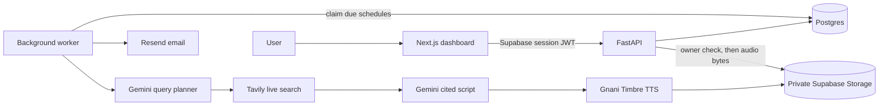

# Daily Context

Daily Context turns a topic and a local delivery time into a source-linked, roughly five-minute audio briefing. Users sign in with a Supabase email link, create or pause daily schedules, and listen to their private episodes from the dashboard. When an episode is ready, the worker emails a link back to that signed-in dashboard.

## How it works



The worker uses Postgres rows as a durable queue. A transaction locks a due briefing, records an episode, and advances the next local-time occurrence. Episode generation moves through `queued`, `generating`, and `ready` or `failed`; stale jobs are recovered after a worker restart. Attempts use exponential backoff. A Postgres advisory lock ensures one active scheduler worker, which also avoids overlapping TTS requests against Gnani account limits. Row-level security is enabled on the application tables, and direct Data API access is revoked from `anon` and `authenticated`; user requests go through FastAPI, which verifies the Supabase token and filters every record by its owner ID.

Research is bounded: Gemini plans up to three complementary searches, Tavily retrieves recent news and source snippets for the selected window, and Gemini writes the cited script using only those snippets. If no sources are found, the job fails rather than inventing an episode. Audio is synthesized with Gnani Timbre and saved in a private bucket. The API checks the verified Supabase user ID on every briefing, episode, and audio request. Audio is fetched through the API, so the bucket and object URLs are never public.

Daily schedules use IANA time zones. A repeated wall time during a daylight-saving transition runs once at the first occurrence; a nonexistent wall time is skipped until the next valid day. If the worker is offline across several scheduled times, it creates one catch-up episode and advances to the next future local-time occurrence.

## Stack

- **Web:** Next.js App Router, React, Supabase Auth magic links
- **API:** FastAPI, SQLAlchemy, PostgreSQL, Supabase JWT verification
- **Worker:** separate always-on Python worker, Postgres queue and advisory lock
- **Research and script:** Tavily Search plus Gemini API
- **Speech:** Gnani Timbre REST TTS, MP3 output
- **Audio storage:** private Supabase Storage bucket
- **Email:** Resend
- **Deployment:** Vercel for the web app, Render for the API and worker, Supabase for Auth, Postgres, and Storage

## Set up the services

1. Create a Supabase project. In the SQL editor, run [`api/migrations/001_initial.sql`](api/migrations/001_initial.sql). Create a **private** Storage bucket named `episodes`.
2. In Supabase Auth, enable email sign-in and configure a transactional SMTP sender for magic links. Set the Site URL to the deployed web URL and add `<web-url>/auth/callback` to the allowed redirect URLs.
3. Get personal API keys for Tavily Search and Gemini. Get the Gnani API key from the dashboard. The app defaults to `gemini-3.5-flash-lite` and Gnani `timbre-v3.0` with voice `Shivani`; each can be changed with environment variables.
4. Set up Resend and verify a sender domain. Set `EMAIL_FROM` to that sender.
5. Create `api/.env` from [`api/.env.example`](api/.env.example) only if it does not already exist. If it does, merge in missing settings so existing keys are preserved. Create `web/.env.local` from [`web/.env.example`](web/.env.example). Use personal keys and keep the Supabase service-role key only in the API and worker environments. Never commit either env file.

The API converts `postgres://` and `postgresql://` database URLs to the `postgresql+psycopg://` SQLAlchemy driver. Use the Supabase Postgres connection string with SSL enabled. The service-role key is used only for server-side access to the private audio bucket.

## Run locally

Apply the SQL migration to the configured Supabase database, then start the API, worker, and web app in separate terminals:

```bash
cd api
uv sync
uv run uvicorn app.main:app --reload --port 8000
```

```bash
cd api
uv run python -m app.worker
```

```bash
cd web
npm install
npm run dev
```

The web app uses `NEXT_PUBLIC_API_URL=http://localhost:8000` by default. The API reads its settings from environment variables. The worker needs database, Supabase Storage, Tavily, Gemini, Gnani, and Resend configuration before it starts.

## Deploy

### Render API and worker

Connect this folder to Render and use [`render.yaml`](render.yaml) as a Blueprint. The API and scheduler are configured as continuously running paid services in Singapore. Add the `DATABASE_URL`, `SUPABASE_URL`, and storage credentials to both services. Add Tavily, Gemini, Gnani, Resend, `EMAIL_FROM`, and the deployed `APP_URL` to the worker. Set the API `CORS_ORIGINS` to the exact deployed web origin.

The worker must stay at one instance while using a Gnani account that allows one active synthesis at a time. The advisory lock stops a second worker from running duplicate schedules. Render charges for these always-on services; the Gnani credit does not cover hosting or other API usage.

### Vercel web app

Import the `web/` directory as the Vercel project root and set `NEXT_PUBLIC_SUPABASE_URL`, `NEXT_PUBLIC_SUPABASE_ANON_KEY` (or the Supabase publishable key), and `NEXT_PUBLIC_API_URL` to the public API URL. After the first deploy, add that URL to Supabase Auth, set `APP_URL` and API `CORS_ORIGINS`, and update the Supabase Auth redirect allow-list.

## API surface

| Method | Path | Purpose |
| --- | --- | --- |
| `GET` | `/health` | Render health check |
| `GET` | `/api/v1/briefings` | List the signed-in user's briefings |
| `POST` | `/api/v1/briefings` | Create a daily schedule |
| `PATCH` | `/api/v1/briefings/{id}` | Pause or resume a schedule |
| `DELETE` | `/api/v1/briefings/{id}` | Delete the schedule, episodes, and stored audio |
| `GET` | `/api/v1/episodes` | List the user's latest 50 episodes |
| `GET` | `/api/v1/episodes/{id}/audio` | Stream private audio after ownership check |

## Project map

- `web/`: sign-in, dashboard, schedule controls, transcript/source view, authenticated playback
- `api/app/main.py`: authenticated API and owner-scoped reads/writes
- `api/app/worker.py`: due-time scheduler, retries, generation and email delivery
- `api/app/research.py`: query planning, current search, source curation and cited script writing
- `api/app/providers.py`: Gnani TTS, Supabase Storage, and Resend integrations
- `api/migrations/001_initial.sql`: initial database schema and queue indexes

## Provider references

- [Gnani TTS REST API](https://docs.gnani.ai/api/TTS/tts-inference)
- [Tavily Search API](https://docs.tavily.com/documentation/api-reference/endpoint/search)
- [Gemini API reference](https://ai.google.dev/api)
- [Supabase JWT verification](https://supabase.com/docs/guides/auth/jwts)
- [Resend email idempotency](https://resend.com/docs/dashboard/emails/idempotency-keys)
